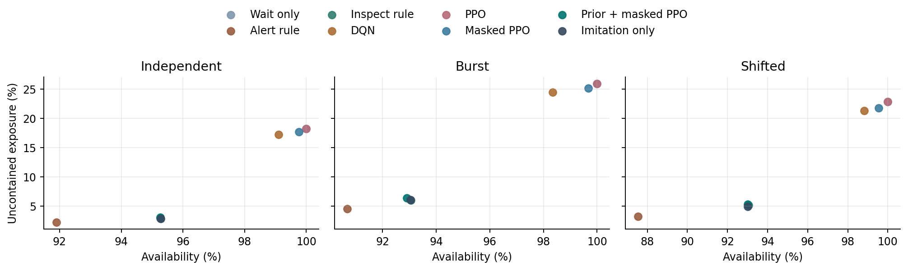
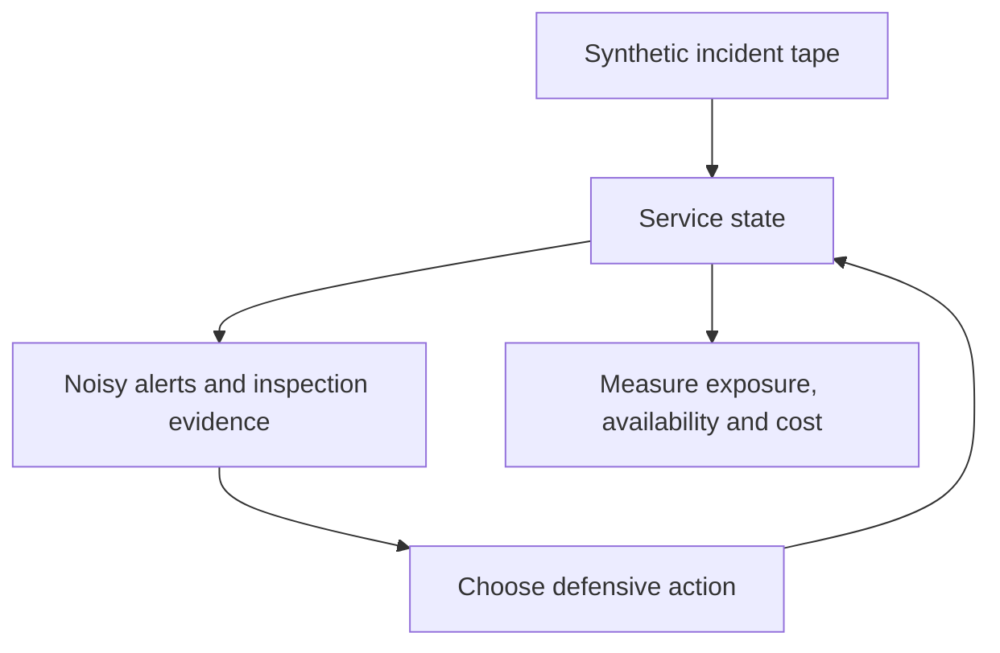
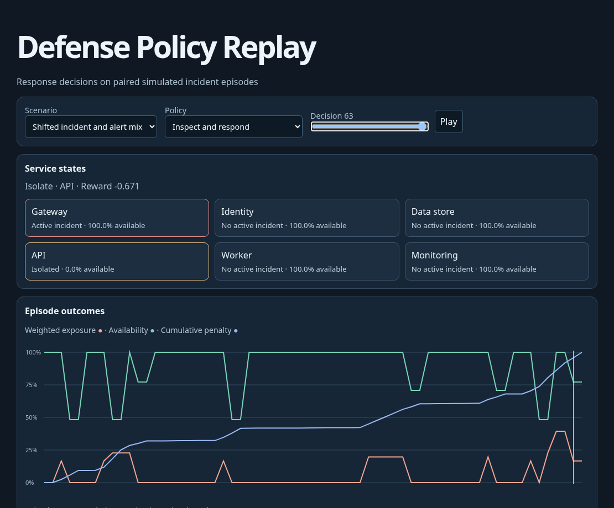

# Reinforcement Learning for Defensive Incident Response

Can a learned policy contain simulated incidents while preserving service availability? This benchmark puts DQN and PPO against alert rules and tests what happens when the action space and training priors change.

## Results

On the held-out shifted scenario, ordinary PPO averaged **43.24 invalid actions per episode**. Restricting PPO to feasible actions reduced that to zero, but balanced return only improved from **−41.01 to −34.49**. Rule initialization brought return to **−14.01**, near the **−13.83** inspect-and-respond rule. Imitation alone scored **−13.49**. The experiment found no average gain from the added reinforcement-learning stage under these conditions.

| Policy, shifted test | Exposure | Availability | Invalid actions per episode | Balanced return |
|---|---:|---:|---:|---:|
| Wait | 22.79% | 100.00% | 0.00 | −35.01 |
| Alert rule | 3.21% | 87.53% | 0.00 | −14.75 |
| Inspect-and-respond rule | 5.16% | 93.06% | 0.00 | −13.83 |
| DQN | 21.31% | 98.81% | 4.81 | −35.00 |
| PPO | 22.79% | 100.00% | 43.24 | −41.01 |
| Masked PPO | 21.73% | 99.55% | 0.00 | −34.49 |
| Rule-initialized masked PPO | 5.29% | 93.01% | 0.00 | −14.01 |
| Imitation only | 4.95% | 93.02% | 0.00 | −13.49 |

The full results include the latent-state oracle, security- and availability-weighted objectives, a no-inspection arm, and paired uncertainty estimates.



## Environment and experiments



The six modeled services share dependencies. The policy selects wait, inspect, isolate or restore. Exogenous tapes define incident timing and alert noise. Experiments use 3,360 policy-episode measurements from 120 matched test tapes and three training seeds per learned arm. The shifted scenario changes incident timing, alert reliability and service weights.

## Reproduce

```sh
python -m venv .venv
source .venv/bin/activate
python -m pip install torch==2.15.0 --index-url https://download.pytorch.org/whl/cpu
python -m pip install -e '.[report]'
OPENBLAS_NUM_THREADS=1 OMP_NUM_THREADS=1 python -m unittest discover -s tests -v
OPENBLAS_NUM_THREADS=1 OMP_NUM_THREADS=1 python -m defense_sim.study
gzip -nc results/study.json > results/study.json.gz
python scripts/report.py
python -m defense_sim.dashboard
```

Run `python -m defense_sim.dashboard` from the repository to build the dashboard directly from measured traces. Open `results/defense-replay.html` and select a scenario and policy to replay actions and outcomes.



[Research report](results/defensive-policy-report.pdf) · [Methodology and citations](docs/METHODOLOGY.md) · [Interview preparation and résumé drafts](docs/INTERVIEW.md)

All actions are local simulation state transitions. The service and incident distributions are synthetic. Real service constraints and calibrated incident data would require independent evaluation. Code development was AI-assisted.
