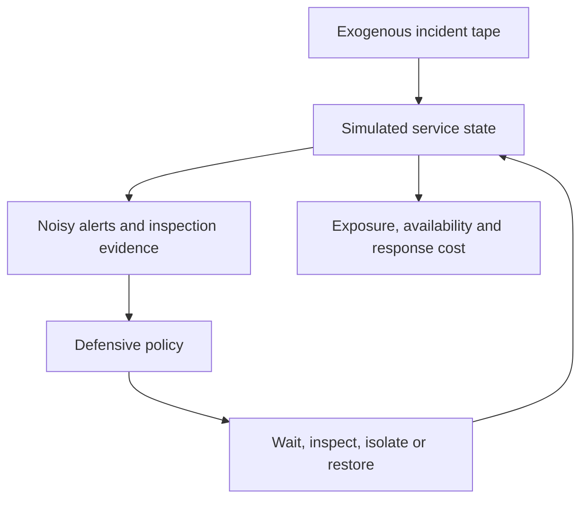

# Methodology

## Questions and hypotheses

Can learned response policies reduce incident exposure while preserving service availability? How do reward weights, inspection feedback, state-dependent action masks, and rule initialization change that trade-off? We expect action masks to eliminate invalid decisions by construction and rule initialization to make coordinated responses easier to learn at a limited interaction budget.

## Environment

The closed simulator contains six synthetic service cells. A pre-generated event tape supplies incident arrivals, expiry counters, telemetry noise, false alert spikes and service values. Incident events are exogenous. The simulator models defensive responses only. The service dependency graph affects availability during isolation or restoration.

The flattened state contains each cell's alert intensity, isolation indicator, last inspection result when fresh, restoration status, and value. Time remaining is observed. Ground-truth incident counters enter measurement and the reward. Policies can wait, inspect one service, isolate one available service, or restore one isolated service. Inspect reveals incident status for a short period; isolate reduces active exposed capacity and can degrade dependent services; restore clears the incident and causes one step of recovery downtime.

The balanced objective uses reward = −2.4·exposure − outage − 0.20·cost per step. Security-oriented and availability-oriented weights are compared in separate PPO arms, with the balanced score used for all final evaluations. Availability and exposure are value-weighted fractions. The study exposes raw component metrics so different preferences can be evaluated.

## Policies and ablations

- Wait-only baseline. Alert-threshold rule. Inspect-and-respond rule. Latent-state oracle with identical defensive actions.
- DQN with replay and a target network. PPO with a clipped policy objective.
- PPO with security-focused and availability-focused rewards, and PPO without inspection feedback.
- Masked PPO removes impossible isolate and restore choices using observed state. The mask uses no latent incident status.
- Rule-initialized masked PPO starts with behavioral cloning of the inspection rule on 40 independent training tapes. An imitation-only arm isolates the contribution of later reinforcement learning. The initialization adds demonstration data.

Train each RL arm with three seeds and 16,384 interactions. The imitation-only arm uses the same demonstrations with zero RL interactions. Select from 4,096, 8,192 and 16,384 steps using fixed validation episode seeds on independent and burst scenarios. Evaluate 40 matched test tapes per scenario. The shifted scenario increases incident arrival in upstream services, changes alert noise and service importance, and is excluded from training and checkpoint selection. Report component means and paired bootstrap intervals by resampling test tapes after averaging the training seeds. Separate checkpoint curves show training variability.

## Limits

Service states and telemetry are synthetic and designed to make trade-offs measurable. The environment has no network adapters or production-system integrations. The capacity model is a fixed synthetic dependency rule, and the results do not translate directly to real incident-response costs. Paired bootstrap intervals describe the simulated test tapes. More training seeds and simulator families are needed for broader conclusions.

## References

- Mnih et al. [Human-level control through deep reinforcement learning](https://doi.org/10.1038/nature14236). Nature, 2015.
- Schulman et al. [Proximal Policy Optimization Algorithms](https://arxiv.org/abs/1707.06347). 2017.
- Standen et al. [CybORG: A Gym for the Development of Autonomous Cyber Agents](https://arxiv.org/abs/2108.09118). 2021.
- [Stable-Baselines3 DQN and PPO documentation](https://stable-baselines3.readthedocs.io/en/master/modules/ppo.html).
